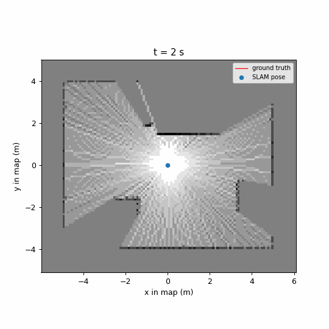

# ROS2_FastSLAM_cpp

[](https://github.com/seifelshafey-dev/ROS2_FastSLAM_cpp/actions/workflows/ci.yml)
[](LICENSE)



*The map built in the simulator during the recorded run, cropped to the room.*

## Overview

This is 2D lidar SLAM on an occupancy grid, with a Rao-Blackwellized particle filter. Each particle carries its own pose and its own map. A scan matcher proposes each particle's new pose from the scan and its map. The core is plain C++17 with no ROS dependency. One ROS 2 node sits on top of it. A reference robot for Ignition Fortress is included so you can try it.

What it is not:

- It is not a loop-closing SLAM. It never corrects earlier poses, so a return to a mapped wall can leave a double wall.
- It is not tuned for a robot of yours. The reference robot is an example, and you are expected to bring your own.
- It is not tested on hardware. See the limitations below.

## Requirements

- Ubuntu 22.04 and ROS 2 Humble.
- A C++17 compiler. I built with GCC 11.4 and GCC 12.
- Ignition Fortress for the simulator, only if you want the reference robot.

The package lists are in [getting-started.md](docs/guide/getting-started.md).

## Quick start

With the container, from a fresh clone:

```bash
docker compose -f docker/compose.yaml run --rm dev
```

Inside the shell:

```bash
cd /ws
colcon build --packages-select slam_cpp
colcon test --packages-select slam_cpp
colcon test-result --verbose
```

On the host, after installing the packages:

```bash
git clone https://github.com/seifelshafey-dev/ROS2_FastSLAM_cpp.git
cd ROS2_FastSLAM_cpp
source /opt/ros/humble/setup.bash
colcon build
source install/setup.bash
ros2 launch robot_bringup slam_sim.launch.py
```

The last command starts the simulator, the robot and the SLAM node. The map is on `/slam/map`. [getting-started.md](docs/guide/getting-started.md) has the package lists, the arguments and the topics.

## How the stack fits together


The simulator publishes a lidar scan and wheel odometry, and the EKF turns the odometry into `odom` to `base_link`. The SLAM node reads the scan and `/odometry/filtered`, and publishes `/slam/map`, `/slam/best_pose`, `/slam/particles` and the `map` to `odom` transform. The core library holds the grid, the scan matcher and the filter. The node only moves messages in and out. [overview.md](docs/architecture/overview.md) has the detail.

## Accuracy

In three live simulator runs of the same drive script (24 m, four laps of a 1.5 m square) the position error was 0.022 to 0.038 m rms (mean 0.028 m). The EKF odometry the filter receives was 0.004 to 0.005 m. The simulator's odometry is near exact, so the filter is worse than odometry alone there. It is a measure of scale, not a win for the filter. The method and the full table are in [accuracy.md](docs/architecture/accuracy.md).

## Documentation

- [Architecture overview](docs/architecture/overview.md)
- [Design pages](docs/design/index.md): one page per derivation
- [Getting started](docs/guide/getting-started.md)
- [Testing](docs/guide/testing.md)
- [Tuning](docs/guide/tuning.md)
- [Figure and accuracy tools](src/slam_cpp/tools/README.md)
- API pages from the header comments, from the repository root: `mkdir -p build && doxygen Doxyfile`. The output goes under `build/docs`.

## Known limitations

The full list is in [limits.md](docs/architecture/limits.md).

- Tested on ROS 2 Humble and in simulation only. It has not been run on a physical robot.
- [No loop closure](docs/architecture/limits.md#no-loop-closure-so-a-double-wall-on-return), so a return to a mapped wall can leave a double wall.
- [The grid has a fixed size](docs/architecture/limits.md#the-map-must-contain-the-whole-mapped-area) and is centred on the start pose.
- [The lidar is assumed to be at the `base_link` origin](docs/architecture/limits.md#the-lidar-is-assumed-to-be-at-the-base_link-origin), with no rotation.
- [Sparse scans can leave the first map too thin](docs/architecture/limits.md#sparse-scans-leave-the-first-map-too-thin), and the pose error then depends on the seed.
- [The pose is not updated below the motion threshold](docs/architecture/limits.md#the-pose-is-not-updated-below-the-motion-threshold), so `/slam/best_pose` moves in steps.

## How it got here

I started from Python scripts and moved the work to a C++ core with a ROS 2 node over it. [dev-journey.md](docs/dev-journey.md) tells how that went.

## Contributing

See [CONTRIBUTING.md](CONTRIBUTING.md).

## License

Apache 2.0. See [LICENSE](LICENSE).
