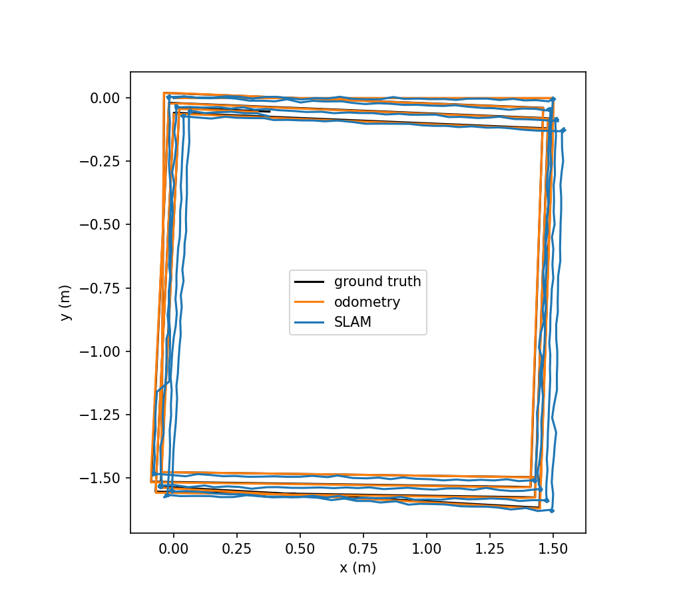
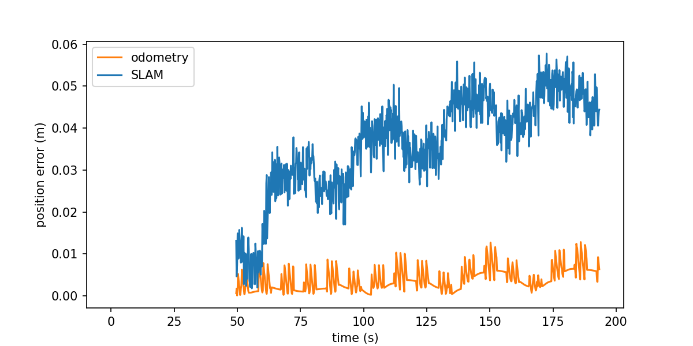

# Accuracy

What I measured about the position error of the SLAM pose, how, and what I could not explain. All of it is in simulation. I have not run the package on a physical robot.

## What is measured

Three live simulator runs of the same drive script ([`drive.py`](../../src/slam_cpp/tools/accuracy/drive.py)): 5 s forward at 0.3 m/s, then turning at -0.4 rad/s until each 8.93 s period ends. The drive lasts 144 s, covers about 24 m and makes four laps of a 1.5 m square. The robot stands still for the first 50 s or so, so a run is about 198 s of simulator time. The code and the drive script are the same in all three runs. The reference robot and room are in [reference-robot.md](reference-robot.md). The shipped parameters were used, with `scan_stride: 1`.

In a live run the node runs beside the simulator and its `/slam/best_pose` is recorded in the bag. The recording starts the bag before the launch, so the bag holds the node's first update. That pose is (0, 0, 0) and defines the map frame. `evaluate.py` exits with status 1 if the first `/slam/best_pose` in a bag is not at the origin, because it would otherwise use the wrong reference. `record.sh` refuses to start while a simulator is running or if the output directory already exists, and it checks that the recorder started. It stops the recorder, the launch and any leftover simulator server when the drive ends, on Ctrl-C or when killed, and exits non-zero if the drive or the recorder failed or a simulator could not be stopped.

The node publishes `/slam/best_pose` once per filter update, stamped with the stamp of the scan that update used. I compare each pose with the simulator's ground truth, interpolated in time to that stamp. The ground truth and the odometry are timed by the bag's record time and the SLAM pose by its scan stamp, so transport delay mainly biases the SLAM figure. The yaw rms bounds that delay to about 0.03 s or less, under 0.01 m of position. Both are expressed in the frame of the first pose, which is how the map frame is defined. The error is the distance between the two positions, and the yaw error is the angle between the two headings. The odometry is scored at the same stamps the same way.

"Moving" is defined in [`evaluate.py`](../../src/slam_cpp/tools/accuracy/evaluate.py): the ground truth moves faster than 0.01 m/s or turns faster than 0.01 rad/s, over a window of 0.25 s on each side of the stamp. In live run 1, 923 of the 924 poses are moving, and the moving-only numbers equal the all-update numbers to three decimals in every run.

I also replay each recording through the node (`evaluate.py <bag> --replay`). The recorded `/scan` and `/odometry/filtered` are played with the simulator clock into a fresh `slam_node`, and the new output is scored the same way. A replay can differ from its live run because the timing of the updates differs.

## Results

Mean and range over the three live runs:

| | mean | range |
|---|---|---|
| SLAM position error, rms | 0.028 m | 0.022 to 0.038 m |
| SLAM position error, max | 0.047 m | 0.040 to 0.058 m |
| SLAM position error, final | 0.022 m | 0.009 to 0.044 m |
| SLAM yaw error, rms | 0.007 rad | 0.006 to 0.008 rad |
| Odometry position error, rms | 0.004 m | 0.004 to 0.005 m |

Each run, live beside its replay:

| | live 1 | live 2 | live 3 | replay 1 | replay 2 | replay 3 |
|---|---|---|---|---|---|---|
| Poses | 924 | 923 | 924 | 923 | 924 | 923 |
| SLAM position error, rms | 0.038 m | 0.022 m | 0.023 m | 0.029 m | 0.022 m | 0.022 m |
| SLAM position error, max | 0.058 m | 0.040 m | 0.044 m | 0.053 m | 0.040 m | 0.040 m |
| SLAM position error, final | 0.044 m | 0.009 m | 0.013 m | 0.042 m | 0.012 m | 0.012 m |
| SLAM yaw error, rms | 0.006 rad | 0.007 rad | 0.008 rad | 0.008 rad | 0.007 rad | 0.006 rad |
| Odometry position error, rms | 0.005 m | 0.005 m | 0.004 m | 0.005 m | 0.005 m | 0.004 m |

The odometry row is the EKF odometry the filter receives (`/odometry/filtered`), fused from wheel odometry and the IMU (see [reference-robot.md](reference-robot.md)), scored the same way. A replay has the same odometry as its live run. The odometry maximum is 0.010 to 0.013 m and its final error 0.005 to 0.007 m.

How to read this:

- The SLAM position error is 0.022 to 0.038 m rms over the three live runs. The odometry alone is 0.004 to 0.005 m.
- The simulator's EKF odometry is close to exact, so the filter is worse than odometry alone here. The comparison shows scale. It is not a win for the filter, and on a robot with real wheel slip it would look different. I have not measured that.
- The final error is measured at the scan stamp of the last update.
- Live run 1 differs from its replay (0.038 m against 0.029 m rms). Runs 2 and 3 agree with their replays within 0.001 m in rms.
- Three runs are three runs. I have no confidence interval.

The published figures (trajectories, error, metrics, demo and map) come from live run 1, the first run and not the best one.

*Trajectories of live run 1 in the map frame: ground truth, EKF odometry and the SLAM pose over the 24 m drive.*

*Position error of the SLAM pose and of the odometry in live run 1, against time, from the scan stamps.*

In the map of that run the walls sit within about one cell of the true wall faces. I see no double wall.

## What I have not explained

The error does not behave the same in every run. In live run 1 it grows from about 0.01 m to about 0.05 m over the run, while the odometry stays near 0.005 m. In live run 2 it does not grow. It rises and falls once per lap of the square (a period of about 36 s) between about 0.01 m and 0.04 m. I do not know why run 1 grows. I offer no cause.

Offline, in an empty room with exact odometry and every beam, the error is 0.0072 to 0.0082 m (`filter_run_dump`, seeds 1 to 6 and 42; see [scan-density.md](../design/scan-density.md)) and does not grow.

## Reproduce

Build and source the workspace, then record one run into a bag directory:

    src/slam_cpp/tools/accuracy/record.sh <bag directory>

This starts the simulator headless, records the topics, runs the drive script and stops. Do not run anything else on the machine meanwhile. Then score the live run:

    python3 src/slam_cpp/tools/accuracy/evaluate.py <bag directory> --out-prefix <prefix>

This prints the numbers above and writes `<prefix>_trajectories.png`, `<prefix>_error.png` and `<prefix>_metrics.json`. `--replay` plays the recorded `/scan` and `/odometry/filtered` into a fresh SLAM node and scores that node's output, so you can test a change on the same inputs without the simulator. Without it, `evaluate.py` scores the `/slam/best_pose` messages stored in the bag, which is the live run. `--map-png <file>` writes the last map with the room's true wall faces.

<!-- release asset link -->
