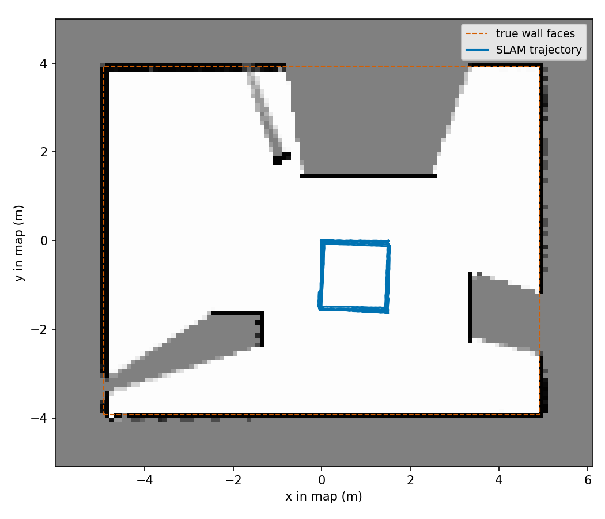

# Limits

What this package does not do, and what I measured about it. Each item says what was run. Where I have not measured, I say so.

In three live simulator runs of the same drive script (24 m, four laps of a 1.5 m square) the position error was 0.022 to 0.038 m rms (mean 0.028 m), and the EKF odometry the filter receives was 0.004 to 0.005 m. In one run the error grew over the drive and in another it did not, and I have not found why. The method, the full table and what I could not explain are in [accuracy.md](accuracy.md).

## Not tested on a robot

I have run the package only in simulation (Ignition Fortress, the room in [reference-robot.md](reference-robot.md)) and in offline runs against a synthetic room. I have not run it on a physical robot. Compilers and platforms I tested are in [environment.md](environment.md).

## No loop closure, so a double wall on return

The filter keeps one map per particle and adds to it as the robot moves. It never goes back to correct earlier poses or to undo earlier map writes. When the robot comes back to a wall it mapped before, its heading error has grown. The scan then hits the wall a little off the old position, and the map gets a second wall beside the first. When the second wall lands nearer than the first, the old cells lie behind it and no ray reaches them. When it lands farther, rays pass through the old cells and add the free increment. I have not measured how often the nearer case happens or how large it is.

I have no recorded measurement of how `alpha1`, `alpha2` or `obs_sigma_gain` change it. This follows from how the method works, not from a setting. A graph-based SLAM keeps the whole trajectory and re-optimises it when a loop is detected, so it can correct this. I did not measure the size of the error on a loop in the numbers on this page.

*Final map of live run 1 (simulator, live run, four laps of a 1.5 m square, 0.1 m cells) with the true wall faces of the room as dashed lines. The mapped walls lie within about one cell of the lines and I see no double wall in this run; the robot sees the same walls throughout, so this run cannot show it.*

## The map must contain the whole mapped area

The grid has a fixed size, `map_size`, and is centred on where the robot started, not on the room. The robot can map only what lies within `map_size / 2` of the start in x and y.

- A scan point off the grid is not written to the map.
- The matcher charges such a point the same as a point in an unknown cell.
- The particle weight does not. It scores an off-grid point as the smallest probability it allows (1e-9), which is about 30 times the penalty of a point in an unknown cell (`log(1e-9) = -20.7` against `log(0.5) = -0.69`, before the weight gain). The two rules disagree. I have not measured what that does to the weights.
- With a wall just past the grid edge, the pose in x was still disturbed in offline tests: grid edge at 4.10 m, walls at 4.13 to 4.30 m, synthetic room. The matcher alone ran on a map built from the true poses, each match started 0.02 m off. After the matcher charged off-grid points as unknown, the match error in x was 0.059 to 0.122 m rms across those runs, and the worst position error 0.18 to 0.35 m. I did not find the cause.

Set `map_size` so that the area, measured from the start pose in every direction, fits with room to spare.

## Beams that return nothing clear nothing

`extract_local_scan` keeps a beam only when its range is finite, above zero, at least `range_min` and below `range_max`. A beam with no return (range at `range_max` or beyond, or infinite) is dropped before it reaches the grid. It writes no hit and also no free cells along its path. Free space is learned only along beams that hit something. So a cell that was once marked occupied is not cleared by a later beam that passes through it without a return.

This is read from the code. I have not measured how often it leaves a stale cell.

## The lidar is assumed to be at the `base_link` origin

The node uses scan points as given, with the lidar at the origin of `base_link` and no rotation. It reads no transform and ignores the frame id of the scan. A lidar mounted elsewhere on the robot is not handled. The odometry pose must also describe the point where the lidar is.

They did not match in an earlier version of the reference robot: the wheels were 0.10 m ahead of `base_link`, so `base_link` was 0.10 m behind the wheel axle, and the odometry described the axle centre. Over 16 turns in place in one simulator run, the true `base_link` swung on a circle of 0.097 to 0.100 m radius, the odometry on 0.001 m, and the SLAM pose on 0.080 m in the first turn and 0.096 to 0.107 m in the other fifteen. I then moved the wheels to `x = 0` of `base_link`, which is the model now.

## Sparse scans leave the first map too thin

If the scan points kept on the walls are far apart compared with a cell, I think the map built from the first scans has gaps; I did not check the cells. The pose error can then be large for the cell size, and it changes with the random seed.

Measured offline with `filter_run_dump` (see [`tools/README.md`](../../src/slam_cpp/tools/README.md)), on an empty rectangular room with exact odometry, range noise 0.01 m and 80 particles. The rms is the position error over the whole run. Seed 42 unless a row lists seeds:

| Kept points | Cell | Wall distance | Point spacing on the wall, in cells | rms error |
|---|---|---|---|---|
| 360 | 0.10 m | 7.9 to 9.9 m | 1.4 to 1.7 | 0.0068 m |
| 180 | 0.10 m | 7.9 to 9.9 m | 2.7 to 3.4 | 0.0518 m |
| 90 | 0.10 m | 3.9 to 4.9 m | 2.7 to 3.4 | 0.2962 m |
| 360 | 0.05 m | 3.9 to 4.9 m | 1.4 to 1.7 | 0.0046 m |
| 180 | 0.05 m | 3.9 to 4.9 m | 2.7 to 3.4 | 0.0738, 0.0217, 0.0170, 0.0419 m (seeds 1, 4, 5, 42) |
| 360 | 0.025 m | 3.9 to 4.9 m | 2.7 to 3.4 | 0.0169 m |

With sparse points the error is large for the cell size and changes with the seed. With every beam it is 0.005 to 0.008 m in the cases at 0.05 and 0.1 m cells, and 0.017 m at 0.025 m cells.

Kept points about three cells apart or more gave the large errors, and the spacing-table rows under two cells apart, at noise 0.01 m with the walls off the cell boundary, gave 0.005 to 0.010 m. The seven-seed row at the old default (180 points, 0.1 m cells, 10 m room, 1.4 to 1.7 cells) gave 0.0091 to 0.0141 m. Other cases under two cells were worse, for example noise 0.03 m (0.0628 m) and a wall face on a cell boundary (0.0504 m). The 0.025 m cell row at three cells apart was in between. So the ratio is a guide measured on empty rectangular rooms, not a law. I have not found the mechanism behind the large errors.

The node measures this ratio at the first scan it uses, as the median range times the angle between kept beams, and logs a warning once when it is above 2 cells. The fix is to lower `scan_stride` or raise `map_resolution`. The matcher itself is unchanged, so a lidar with few beams, a large `scan_stride` or walls far away can still reach this state. The warning is a guide. Nothing stops the node.

## Half a cell of steady offset

When a wall face lies exactly on a cell boundary, the pose can sit half a cell off the true one. Measured offline with `filter_run_dump`, 360 points, 0.1 m cells, an empty room, noise 0.01 m: wall faces at x = ±4.900 m or ±5.000 m gave a mean error in x of +0.050 m (rms 0.0504 and 0.0505 m). Faces at ±4.950 m gave 0.000 m (rms 0.0062 m) and at ±4.975 m a mean of -0.014 m (rms 0.0181 m). With range noise 0.03 m in the default room the rms was 0.0628 m with 360 points. I think this comes from the grid and not the matcher, but I have not shown the mechanism. I did not measure it at other cell sizes.

## The pose is not updated below the motion threshold

After the first scan, the node uses a scan only when the odometry has moved more than `motion_threshold_trans` (0.05 m) or turned more than `motion_threshold_rot` (0.05 rad) since the last update. In between, no new best pose or particle message is published, and the `map` to `odom` transform stays at its last value. The `odom` to `base_link` transform from the EKF keeps moving, so a consumer that chains the two sees smooth motion. A consumer that reads `/slam/best_pose` directly sees steps.

## Motion noise is added twice, and the prior is floored

`predict` adds noise to each particle's motion, and the filter then samples again around the matched pose. The matcher raises each diagonal of the prior covariance to at least 0.01, which makes the propagated covariance have no effect I could measure. On a 24 m circular path in a synthetic room with walls on all sides (180 points, seeds 1 to 5 and 42, exact odometry, an earlier commit than the present one), replacing the propagated covariance by a constant gave the same rms error to four decimal places (mean rms 0.0350 m). I did not measure a corridor, where a scan does not constrain one axis and the prior would decide.

## The IMU's contribution in the reference robot is not measured

`ekf.yaml` is set to fuse the IMU yaw, yaw rate and acceleration. In the two recordings I checked, the fused yaw equalled the wheel yaw to four decimal places (-25.1328 in both for one of them). I have not recorded whether `/imu/data` carries messages. I make no claim that the reference robot's odometry uses the IMU.

## Time

Measured with `filter_run_dump`, Release -O3, OpenMP on, 12 cores, 80 particles, 0.1 m cells, 714 updates, whole-program wall time (scan generation and CSV writing included), on an otherwise idle machine: 3.5 to 3.8 s with 180 points and 6.0 to 6.2 s with 360, two runs each, about 5 ms and 8.5 ms per update. I have not measured the node's load in the simulator.
