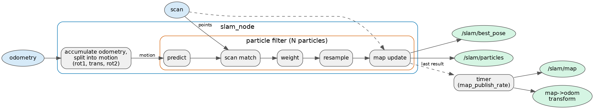

# Overview

I wrote a 2D lidar SLAM package for ROS 2 Humble. It builds an occupancy grid map and estimates where the robot is on that map. It does this with a Rao-Blackwellized particle filter: every particle carries a pose and its own map.

This page is the map of the package. The other pages in this folder give the detail:

- [core.md](core.md): the grid, the scan matcher and the filter.
- [ros.md](ros.md): the node, its topics, frames and parameters.
- [reference-robot.md](reference-robot.md): the robot and simulator I use to try it.
- [config.md](config.md): every setting and what it trades.
- [module-map.md](module-map.md): which file does what.
- [environment.md](environment.md): what it was built and tested on.
- [limits.md](limits.md): what it does not do, with the measurements.
- [accuracy.md](accuracy.md): the measured position error in simulation.

Over three live simulator runs of the same 24 m drive the position error was 0.022 to 0.038 m rms (mean 0.028 m), against 0.004 to 0.005 m for the EKF odometry the filter receives. The method and what I could not explain are in [accuracy.md](accuracy.md).

## What goes in and what comes out

In: `nav_msgs/Odometry` (default `/odometry/filtered`) and `sensor_msgs/LaserScan` (default `/scan`).

Out: a map (`/slam/map`), the particle poses (`/slam/particles`), the pose of the best particle (`/slam/best_pose`), and the transform from `map` to `odom`.

The node is [`slam_node.cpp`](../../src/slam_cpp/src/ros/slam_node.cpp). Its class comment is the owner of the topic and parameter lists.

## Data flow

*Block diagram of the node: odometry and scan go in, the particle filter sits inside, and the map, the best pose, the particles and the map to odom transform come out.*

1. Each odometry message adds its change in pose to a running total. Nothing else happens on an odometry message.
2. The first valid scan is written into every particle's map at the starting pose. This defines the map frame: the origin of `map` is the robot pose at that moment.
3. Each later scan is used only if the odometry total since the last update passes the motion threshold (0.05 m or 0.05 rad by default). Otherwise the scan is dropped and the total keeps growing.
4. The odometry total is split into a turn, a move and a second turn. The filter moves every particle by that motion plus noise.
5. Each particle's pose is matched against its own map: a coarse search over nearby poses, then a Levenberg-Marquardt refinement. The particle is then given a pose sampled around the refined one, and a weight from how well the scan fits.
6. If the weights have become too uneven, the particles are resampled.
7. If the best particle has moved far enough since the last map write, every surviving particle's map takes the scan.
8. The scan callback publishes the best pose and the particles at each update. A timer (`publish_callback` in [`slam_node.cpp`](../../src/slam_cpp/src/ros/slam_node.cpp), every half second by default) publishes the map and the `map` to `odom` transform, from the result of the last update.

Details of steps 4 to 7 are in [core.md](core.md). Steps 1 to 3 and 8 are in [ros.md](ros.md).

## The modules

**Occupancy grid.** A square grid of cells centred on the map origin. Each cell is one signed byte holding log-odds times a scale. A copy of a grid shares its cells until one copy is written, so resampling does not copy every map. See `OccupancyGrid` in [`occupancy_grid.hpp`](../../src/slam_cpp/include/slam_cpp/occupancy_grid.hpp).

**Scan matcher.** Free functions that score a scan against a grid and refine a pose. They read a grid through a read-only view. See [`scan_matching.hpp`](../../src/slam_cpp/include/slam_cpp/scan_matching.hpp).

**Particle filter.** Holds the particles, runs the motion model, calls the matcher once per particle, samples, weights, resamples and writes the maps. Matching runs in parallel with OpenMP when it is available. A fixed seed gives the same result for any thread count. See `ParticleFilter` in [`particle_filter.hpp`](../../src/slam_cpp/include/slam_cpp/particle_filter.hpp).

**Odometry helpers.** Split a motion into turn, move, turn, and build the `map` to `odom` transform. See [`odometry.hpp`](../../src/slam_cpp/include/slam_cpp/odometry.hpp).

**Configuration.** One struct, `SlamConfig`, and `validate`, which rejects a setting that cannot run. See [config.md](config.md).

**Node.** The only code that uses ROS. The rest is a plain C++17 library, `slam_core`, that builds and runs its tests without ROS. See [environment.md](environment.md).

## Conventions that hold everywhere

- A pose is `(x, y, theta)` in the map frame, in metres and radians. `theta` is in `[-pi, pi)`.
- Scan points are in the robot's base frame. I assume the lidar sits at the `base_link` origin with no rotation, so no transform is looked up.
- Row is y, column is x, storage is row-major.

The grid indexing and the angle range are in [core.md](core.md).

The derivations behind these choices, with the tests that check them, are in the [design pages](../design/index.md).
