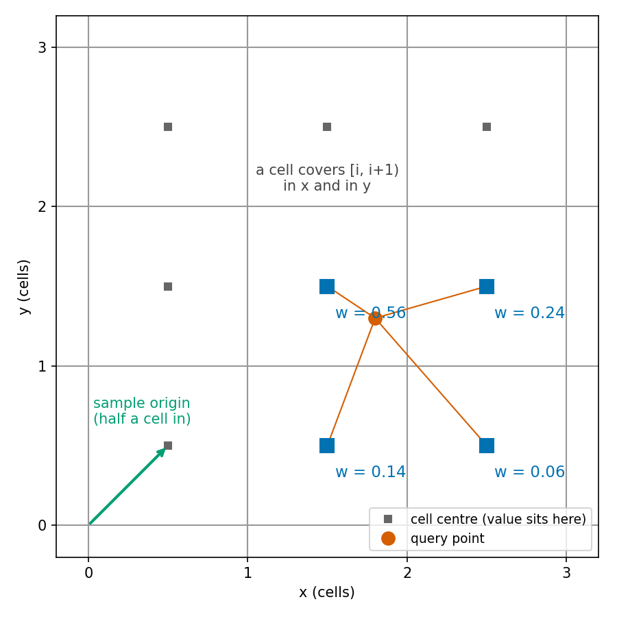

# The grid: indexing, storage and where a cell's value sits

This page settles three things. How a point in metres becomes a cell. What a cell stores. And where, between cells, I take a cell's value to sit when the matcher reads the map. The last one cost me a half-cell bias once, so I derive it here.

The code is in [`occupancy_grid.cpp`](../../src/slam_cpp/src/occupancy_grid.cpp), [`slam_types.hpp`](../../src/slam_cpp/include/slam_cpp/slam_types.hpp) (`GridView`) and [`scan_matching.cpp`](../../src/slam_cpp/src/scan_matching.cpp) (`bilinear_interpolation`). Test paths are relative to [`../../src/slam_cpp/test/`](../../src/slam_cpp/test/). The current behaviour in short is in [core.md](../architecture/core.md).

Symbols:

| Symbol | Code name | Unit |
|---|---|---|
| `res` | `map_resolution` | m per cell |
| `cols`, `rows` | `OccupancyGrid::cols()`, `rows()` | cells; equal, even |
| `s` | `log_odds_scale` | stored units per log-odds unit |
| `(x, y)` | world point, map frame | m |
| `(c, r)` | `GridCoord{x, y}`: column, row | cells |

## Cell index

```
c = floor(x / res) + cols / 2
r = floor(y / res) + rows / 2
```

`cols / 2` is integer division of an even number. The index floors. Truncation would put `x = -0.05 m` at 0.1 m cells into the origin cell. Flooring puts it in the cell to the left.

A cell `c` covers `[c - cols/2, c - cols/2 + 1)` in cell units. That is inclusive at the lower edge and exclusive at the upper edge. Its centre is at `(c - cols/2 + 0.5) * res` in metres. A point is on the grid when `0 <= c < cols` and `0 <= r < rows`. Row is y, column is x, storage is row-major. The grid is square and the world origin lies on the boundary between cells `cols/2 - 1` and `cols/2`, not in the middle of a cell.

The number of cells per side is `lround(map_size / res)`, which `validate` requires to be whole, even and at most 20000.

Checked by `OccupancyGridTest.WorldToGridCenter` and `OccupancyGridTest.WorldToGridOutOfBounds` (`occupancy_grid_test.cpp`). The out of bounds test probes 24.9 and -24.9 m inside and 100 and -26 m outside, so the edge itself is untested.

## What a cell stores

A cell is an `int8`. Write `v` for the stored value. The log-odds of occupancy is `v / s`, and the occupancy probability is

```
p = 1 / (1 + exp(-v / s))
```

read from a 256 entry table (`SigmoidLUT` in [`sigmoid_lut.hpp`](../../src/slam_cpp/include/slam_cpp/sigmoid_lut.hpp)). Zero is unknown and gives `p = 0.5`.

An observation adds an integer step to `v`. Each step is the config value times `s`, rounded to the nearest integer (`lround`, halves away from zero). Then `v` is clamped:

```
v <- clamp(v + step, lo_min_scaled, lo_max_scaled)
```

At the defaults (`s = 20`, `lo_occupied = 0.85`, `lo_free = -0.4`, limits `+-5`) the steps are `+17` and `-8` and the limits are `+-100`. The arithmetic is done in `int`, so the sum cannot overflow before the clamp. A cell at the occupied limit needs 13 free observations to go below zero.

Rounding matters when a step is not a whole number of stored units. The cell then moves by the rounded step, not by the log-odds I typed. `validate` refuses a step that rounds to zero.

Checked by `OccupancyGridTest.LogOddsClamping` for the clamp and `SlamConfig.ScaledAccessorsRound` for the rounding (`slam_config_test.cpp`). No test checks the table values on their own; `ScanMatchingTest.InterpolationAtCellCentreFromWorldReturnsCellValue` reads one back through it.

## Writing a scan

For each scan point the grid moves it to the map frame with the pose, finds its cell, and walks an integer Bresenham line from the robot's cell to that cell. Every cell on the line except the last gets the free step. The last gets the occupied step. Each beam adds its own steps, so a cell crossed by several beams in one scan is changed several times. Nothing removes duplicates.

- A point whose cell is off the grid is skipped, so no wall appears at the grid edge.
- If the robot's cell is off the grid, nothing is written.
- A beam that returns nothing never becomes a scan point, so it clears no cells. See [limits.md](../architecture/limits.md).

Checked by `OccupancyGridTest.BresenhamDrawsCorrectLine` and `OccupancyGridTest.UpdateIntegratesFullScan` (`occupancy_grid_test.cpp`). They check the sign of a hit cell, a ray cell and a far cell. No test checks the three bullets above.

## Where a cell's value sits when it is read

The writer above treats a whole cell as the place a hit landed. A hit anywhere in `[c, c+1)` cell units goes to cell `c`. So the best single place to say "cell `c` has this value" is the middle of that interval, the cell centre.

The matcher reads the map by bilinear interpolation. It blends the four cells around a point. A blend needs a coordinate for each cell. I call it the sample coordinate `sx`, and I want cell `c` to sit at `sx = c`. A point at the cell centre `x / res = c - cols/2 + 0.5` must then give `sx = c`. Solve for the offset:

```
sx = x / res + sample_origin
c  = (c - cols/2 + 0.5) + sample_origin
sample_origin = cols/2 - 0.5
```

`GridView::sample_origin` is that value, and `make_grid_view` sets it from `origin_x - 0.5`. The same offset serves y because the grid is square.

With `x0 = floor(sx)`, `fx = sx - x0` and likewise `y0`, `fy`, the blended probability is

```
p = (1-fx)(1-fy) p(x0,y0) + fx(1-fy) p(x0+1,y0) + (1-fx) fy p(x0,y0+1) + fx fy p(x0+1,y0+1)
```

where each `p(.,.)` is the table value of that cell. I blend probabilities, not log-odds. A point is usable only when `0 <= x0`, `x0 + 1 < cols` and the same in y. In metres that is the grid shrunk by half a cell on every side: `-cols/2 + 0.5 <= x/res < cols/2 - 0.5`. A point inside the last half cell of the grid is written to the map but counts as off the grid for matching.

### What it did before

Before I fixed this, the offset was `cols/2` with no `- 0.5`. The reader then took cell `c` to sit at its lower corner while the writer filled the whole cell. A wall written into a cell was found half a cell towards the lower corner. This is the measurement. The setting was an offline probe, not the simulator: a synthetic rectangular room with walls at +-4.03 m and +-3.02 m, 180 beams, range noise 0.01 m, a 24 m circular path of 400 updates, 80 particles, seed 42. I did not record the cell size of the probe. Half a cell at the shipped 0.1 m is 0.05 m.

| Reader | Matching each scan against a map built from the true poses: mean error (x, y) | Full filter, exact odometry: final error (x, y) |
|---|---|---|
| corner (before) | (-0.0501, -0.0490) m | (-0.419, -0.417) m, rms position error 0.432 m |
| centre (after) | (-0.0001, +0.0010) m | (-0.067, +0.002) m, rms 0.078 m |

The "after" row was taken with the offset changed in a scratch copy, before the same change went into the code. This is one seed and one room.

As I read the paper, Hector SLAM also reads the map by bilinear interpolation between cell centres. I have not compared my coordinates with its source line by line.



*Bilinear weights of the four cell centres around a query point; a cell's value sits at its centre, so the sample origin is half a cell in.*

Checked by `ScanMatchingTest.InterpolationAtCellCentreFromWorldReturnsCellValue`, `ScanMatchingTest.InterpolationOnCellBoundaryFromWorldIsMeanOfCells` (`scan_matching_test.cpp`), `ScanMatchingProperty.WrittenHitIsReadAtCellCentre` (`scan_matching_property_test.cpp`) and `ScanMatchingIntegration.ScanMatchOnKnownPoseMapHasNoBias` (`scan_matching_integration_test.cpp`). The last one bounds the mean match error by 0.01 m per axis on a map built from true poses.

## Copy on write

A copy of a grid shares its cell array through a reference count. `update` is the only function that writes. It makes the array unique first, copying it if the count is above one. A resample therefore costs a pointer copy per particle, and a copy pays for itself only when it is first written.

Checked by `OccupancyGridTest.COWSharesUntilWrite` (`occupancy_grid_test.cpp`).

## Assumptions and limits

- The reading rule assumes a hit lands uniformly inside its cell. A wall face that lies exactly on a cell boundary does not satisfy that, and I measured a steady half-cell offset in that case. See [limits.md](../architecture/limits.md).
- The quality counters and the sigmoid are per cell and know nothing about neighbours.
- Stored values are at most 127 in magnitude. At `s = 20` one stored unit is 0.05 log-odds, so a step is stored as the nearest multiple of 0.05, and one that rounds to zero is refused.
