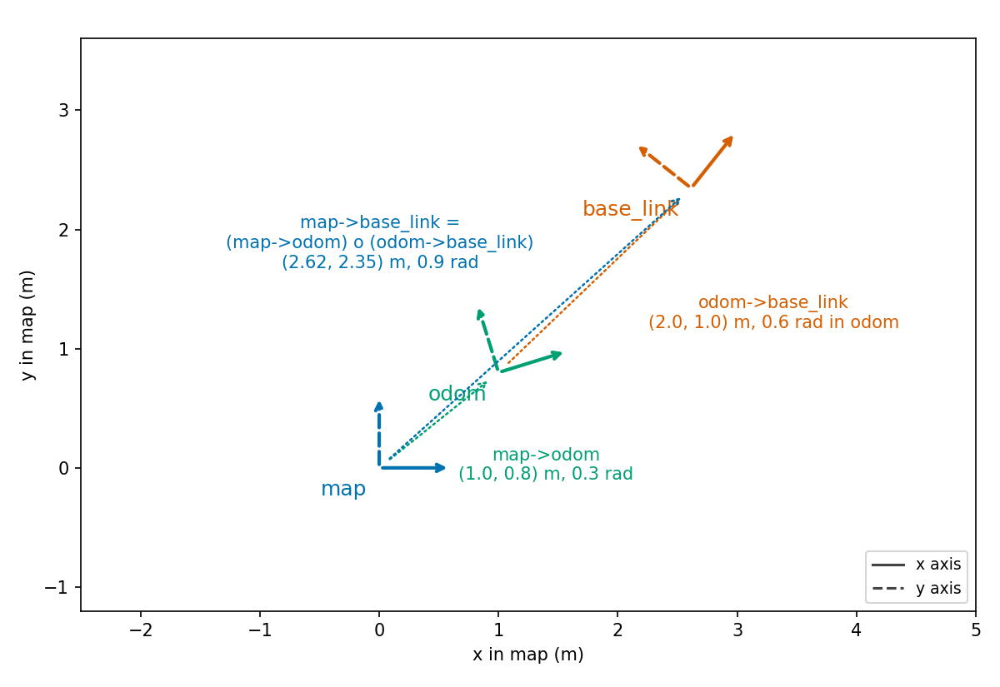

# Odometry split and the map to odom transform

This page settles two things. How I turn the odometry that arrived since the last update into the three controls of the motion model. And how I build the `map` to `odom` transform so that it stays still between updates. The code is [`odometry.cpp`](../../src/slam_cpp/src/odometry.cpp), with the interface in [`odometry.hpp`](../../src/slam_cpp/include/slam_cpp/odometry.hpp), and the callbacks in [`slam_node.cpp`](../../src/slam_cpp/src/ros/slam_node.cpp).

Test paths are relative to [`../../src/slam_cpp/test/`](../../src/slam_cpp/test/).

Symbols:

| Symbol | Code name | Unit and frame |
|---|---|---|
| `(dx, dy)` | `accum_dx_`, `accum_dy_` | m; odom frame; summed since the last update |
| `dth` | `accum_dth_` | rad; summed and wrapped to `[-pi, pi)` |
| `th0` | `start_seg_th_` | rad; odom heading at the last update |
| `t`, `rot1`, `rot2`, `dir` | `MotionDelta` | m, rad, rad, +1 or -1 |
| `S` | best particle's pose | m, m, rad; map frame |
| `O` | odometry pose stored at the update | m, m, rad; odom frame |
| `T` | `map_to_odom(S, O)` | pose of the odom frame in the map frame |

## Accumulating odometry

Each odometry message gives a pose `(x, y, yaw)`. The node does not look at the child frame or the header frame. The first message only sets the reference. Each later message adds the difference from the previous one to `(dx, dy)` and the wrapped difference of the yaw to `dth`. A scan then reads the totals. When an update runs, the totals are reset and `th0` becomes the latest odometry yaw.

This keeps only the net displacement since the last update. If the robot drove a curve in between, the curve is replaced by its chord. The gate (0.05 m or 0.05 rad of motion by default) keeps the chord short. I did not measure how much a curve costs at the largest motion the gate allows.

## Splitting into turn, move, turn

`decompose_motion(dx, dy, dth, th0)` returns `t`, `rot1`, `rot2` and `dir`:

```
t = hypot(dx, dy)

if t < 0.01 m:
    rot1 = 0,  rot2 = wrap(dth),  dir = +1
else:
    rot1 = wrap( atan2(dy, dx) - th0 ),  dir = +1
    if |rot1| > pi/2:                              (the robot drove backwards)
        rot1 = wrap( atan2(-dy, -dx) - th0 ),  dir = -1
    rot2 = wrap( dth - rot1 )
```

`wrap` returns an angle in `[-pi, pi)`. Replaying the result reproduces the segment: turn by `rot1`, move `dir * t` along the new heading, turn by `rot2`. In the reverse case the move is `-t` along `th0 + rot1`, and `th0 + rot1` is the bearing of `(-dx, -dy)`, so the move lands on `(dx, dy)`. The heading ends at `th0 + dth`.

Two choices are mine.

- Below 1 cm the bearing of the displacement is mostly noise, so I take it as a pure rotation. The filter still receives `t` (below 1 cm), so a particle moves along its old heading by that amount. I did not measure the error this makes.
- Reverse is detected from the bearing alone, at exactly `pi/2` from the heading. At that angle the decomposition is not unique: a sideways move can be read as either. The tests keep 0.01 rad away from it. A robot that moves sideways, which a differential-drive robot does not, would be misread.

Checked by `Odometry.PureRotation`, `Odometry.StraightForwardAlongStartHeading`, `Odometry.StraightReverse`, `Odometry.SidewaysBelowThresholdIgnoresBearing`, `Odometry.SidewaysAboveThresholdUsesBearing`, `Odometry.HeadingChangeNearPiWraps` (`odometry_test.cpp`), and `OdometryProperty.ForwardMotionRoundTrips`, `OdometryProperty.ReverseMotionRoundTrips`, `OdometryProperty.DecomposeOutputsAreInRange` (`odometry_property_test.cpp`).

## The motion gate

After the first scan the node uses a scan only when `t` exceeds `motion_threshold_trans` or `|dth|` exceeds `motion_threshold_rot`. Otherwise the scan is dropped and the totals keep growing. The comparison is strict. No test covers the node, so no test checks the gate. It rests on the code as read.

## The map to odom transform

The filter's pose `S` is in the map frame. The odometry pose is in the odom frame, and something else (in my setup the EKF) publishes the transform from `odom` to `base_link`. What I broadcast must be the pose of `odom` in `map`, `T`, such that composing it with the odometry pose gives the SLAM pose:

```
compose(T, O) = S
```

`compose(a, b)` puts `b`, given in the frame of `a`, into the frame `a` is in: `xy = a.xy + R(a.theta) * b.xy` and `theta = wrap(a.theta + b.theta)`. Solving for `T`:

```
T = compose(S, inverse(O))
T.theta = wrap(S.theta - O.theta)
T.xy    = S.xy - R(T.theta) * O.xy
```

The second line is `compose(T, O).xy = T.xy + R(T.theta) O.xy = S.xy`. The first is the heading.

### Why both poses come from one moment

At each SLAM update the node stores the odometry pose `O` that belongs to that update. The broadcast then uses `S` of the best particle and that stored `O`, at every publish until the next update.

Suppose a consumer reads `odom` to `base_link` at a later time and gets `O_now`. It computes the pose in the map as `compose(T, O_now)`. With my `T`:

```
compose(T, O_now) = compose(S, compose(inverse(O), O_now))
```

That is the SLAM pose, moved by the odometry motion since the update. The pose is corrected by the filter and still smooth between updates.

If I built `T` from `S` and `O_now` instead, the consumer would get `compose(T, O_now) = S` at all times. The robot would appear frozen at its last SLAM pose between updates. `T` would also change at every publish. So the two poses must belong to the same moment.

The transform is stamped with the node clock at publish time, while `/slam/best_pose` carries the scan stamp, so the two stamps differ.

Checked by `Odometry.MapToOdomOfEqualPosesIsIdentity`, `Odometry.MapToOdomHandComputedWith90DegreeHeadingDifference` (`odometry_test.cpp`), `OdometryProperty.ComposeMapToOdomWithOdomGivesSlamPose` and `OdometryProperty.ComposeWithInverseIsIdentity` (`odometry_property_test.cpp`). Those check the algebra. No test checks that the node stores `O` at the update and passes that one. That rests on the code as read.



*One instant: map to odom (1.0, 0.8, 0.3) composed with odom to base_link (2.0, 1.0, 0.6) gives the pose of base_link in the map, (2.62, 2.35, 0.9).*

## Assumptions and limits

- The stored `O` is the latest odometry message when the scan is processed. I do not interpolate it to the scan's time stamp. In one simulator run (first straight, 81 scans, 0.3 m/s) the latest message differed from the odometry at the scan stamp by 0.005 m on average, and scans arrived 0.017 s after their stamp. I did not measure this on another robot.
- The node assumes that the odometry topic and the `odom` to `base_link` transform describe the same pose. I did not check that for an odometry source other than the reference robot's EKF.
- `S` is the pose of the lidar, taken as the `base_link` origin. An odometry source that reports another point on the robot gives a wrong `T`. I measured this on an earlier version of the reference robot. See [limits.md](../architecture/limits.md).
