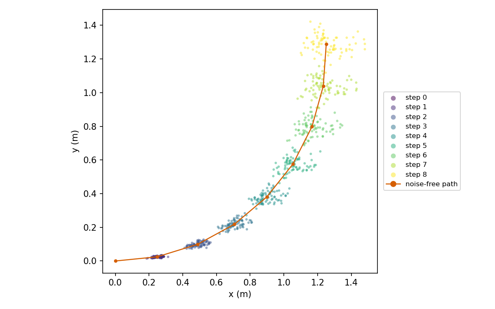

# The motion model

This page settles how `predict` moves a particle, how big the noise is, and how the covariance is carried along. The code is `ParticleFilter::predict` in [`particle_filter.cpp`](../../src/slam_cpp/src/particle_filter.cpp). How the node turns two odometry poses into the three controls is in [map-odom.md](map-odom.md).

Test paths are relative to [`../../src/slam_cpp/test/`](../../src/slam_cpp/test/).

Symbols:

| Symbol | Code name | Unit |
|---|---|---|
| `rot1`, `rot2` | `rot1`, `rot2` | rad, in `[-pi, pi)` |
| `t` | `trans` | m, 0 or more |
| `dir` | `direction` | +1 forward, -1 reverse |
| `a1` to `a4` | `alpha1` to `alpha4` | `a1` none, `a2` rad per m, `a3` none, `a4` m per rad |
| `(x, y, theta)` | a particle's pose | m, m, rad; map frame |
| `P` | one particle's covariance, `covs_[i]` | 3 by 3, same units as the pose |

## Moving a particle

The motion is a turn, a straight move and a second turn. For each particle I draw three independent Gaussian errors. Their standard deviations are linear in the size of the motion:

```
sd_rot1  = a1 * |rot1| + a2 * t               + 1e-9
sd_trans = a3 * t      + a4 * (|rot1| + |rot2|) + 1e-9
sd_rot2  = a1 * |rot2| + a2 * t               + 1e-9
```

The `1e-9` keeps a standard deviation above zero when the motion is zero. Then, with `e1, e2, e3` drawn as `N(0, sd_rot1)`, `N(0, sd_trans)`, `N(0, sd_rot2)`:

```
rot1' = rot1 - e1
t'    = t    - e2
rot2' = rot2 - e3
h     = theta + rot1'
x     <- x + dir * t' * cos(h)
y     <- y + dir * t' * sin(h)
theta <- wrap(theta + rot1' + rot2')
```

`wrap` is `normalize_angle`, which returns an angle in `[-pi, pi)`. The errors are symmetric, so subtracting them or adding them gives the same distribution. All random numbers come from the filter's one generator, on the calling thread.

With the shipped values (`a1 = a3 = 0.075`, `a2 = a4 = 0.03`) and a pure move of `t = 0.05 m`, which is the node's default motion threshold, the standard deviations are `sd_rot1 = 0.0015 rad` and `sd_trans = 0.00375 m`. A turn of 0.05 rad with no move gives `sd_rot2 = 0.00375 rad` and `sd_trans = 0.0015 m`. This is arithmetic from the formulas, not a measurement.

**How it differs from the book.** The structure is the odometry motion model of Probabilistic Robotics (Thrun, Burgard and Fox, chapter 5; the sampling algorithm is Table 5.6). As I read that table, the noise there is a draw whose variance is `alpha1 * rot1^2 + alpha2 * t^2` and the like, so its alphas multiply squared quantities and the standard deviation is a square root of a sum. Here the alphas multiply the quantities themselves and the standard deviation is their plain sum. The two are not the same for equal alphas, so values from the book do not carry over. I have not compared the table line by line while writing this page.

Checked by `ParticleFilterTest.PredictZeroNoiseExactMotion` and `ParticleFilterTest.PredictReverseDirection` (`particle_filter_test.cpp`) for the noise-free motion and the direction sign. `ParticleFilterTest.PredictWithNoiseSpreadsPoses` only checks that the particles spread. No test checks the standard deviation formulas, so they rest on the argument above.

## Carrying the covariance

Each particle also carries a covariance `P`. I propagate it with the first-order (linearised) rule:

```
P <- F P F^T + G M G^T + 1e-6 I
M = diag(sd_rot1^2, sd_trans^2, sd_rot2^2)
```

With `s = sin(h)`, `c = cos(h)` and `u = dir * t'`:

```
F = [ 1  0  -u*s ]        G = [ -u*s   dir*c   0 ]
    [ 0  1   u*c ]            [  u*c   dir*s   0 ]
    [ 0  0   1   ]            [  1     0       1 ]
```

These are the derivatives of the pose update above. `F` is with respect to the old pose, `G` with respect to `(rot1, t, rot2)`. The columns of `G` for `rot1` and `rot2` differ because only `rot1` changes the heading `h` at which the move happens. They are evaluated at the noisy controls that were just drawn.

`M` uses the formula standard deviations, not the drawn errors. The `1e-6 I` keeps `P` positive definite.

The covariance is not used to draw the noise above. It reaches the filter only as the prior of the scan matcher, and the matcher raises its diagonal to at least 0.01. See [scan-matching.md](scan-matching.md). For a 0.05 m step the motion variance is about `(0.075 * 0.05)^2 = 1.4e-5`, about 700 times below that floor. I measured that replacing the propagated covariance by a constant gave the same whole-run rms error to four decimal places (24 m circle, synthetic room with walls on all sides, seeds 1 to 5 and 42, exact odometry, 180 points). So in the cases I tried, the propagation has no effect. A corridor, which I did not measure, could make it matter.

No test checks the values of `F`, `G` or `P`. `ParticleFilterTest.PredictCovarianceGrows` only checks that particles spread after a motion. This section rests on the argument above.

## Noise is added twice

`predict` adds noise to the motion. Later, `update_and_resample` matches the scan from that noisy pose and then samples again around the matched pose. So a step has two noise sources. FastSLAM 2.0 centres the prior on the noise-free prediction and samples once, from the proposal. The GMapping code, as I read it, samples the motion model, scan-matches from there and keeps the matched pose. As I read them, mine is a mix of both. I measured two cheap variants of the prior (the constant covariance above and a lower floor, in [scan-matching.md](scan-matching.md)) and found no difference larger than the spread between seeds. I did not build the one-noise-source versions, so I cannot say what they would change. I kept the structure.



*80 particles after each of 8 steps of 0.25 m and 0.2 rad with the default noise and no scan update.*

## Assumptions and limits

- The three errors are independent and Gaussian. Real wheel slip is neither.
- The linearisation holds for the small steps the motion threshold allows. I did not test large steps.
- The alphas are the same for every robot until someone tunes them. I have no measurement that says what a good value is for the reference robot. See [config.md](../architecture/config.md).
- A net move under 1 cm is treated as pure rotation by the node. See [map-odom.md](map-odom.md).
