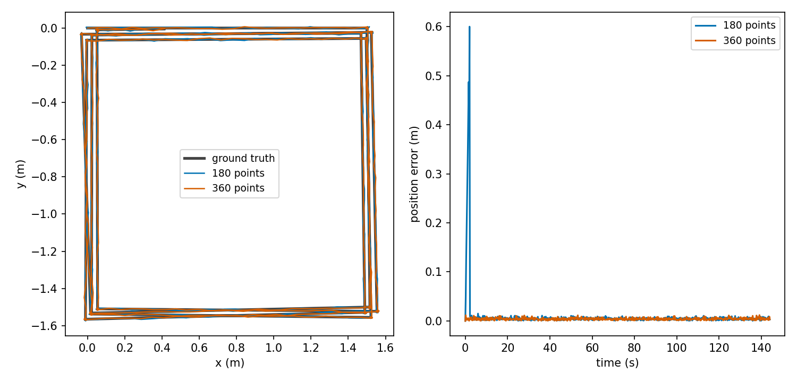

# Scan density and the first map

This page settles why a scan with few points on a wall can give a large error, what I measured, what I tried, what I changed, and what is still open. I mark each statement as measured, or as my reading. A statement I measured comes with its conditions. A reading I could not test is called a reading.

The change is in [`scan_matching.cpp`](../../src/slam_cpp/src/scan_matching.cpp) (`median_point_spacing`), [`slam_node.cpp`](../../src/slam_cpp/src/ros/slam_node.cpp) (the warning) and [`slam_params.yaml`](../../src/slam_cpp/config/slam_params.yaml) (`scan_stride`). Test paths are relative to [`../../src/slam_cpp/test/`](../../src/slam_cpp/test/).

## What I saw

I first saw this in the simulator. The pose error at rest at the end of a run varied between 0.01 and 0.05 m from one run of the same drive script to the next. I could not explain the spread. I then looked for it with no simulator, on a synthetic empty rectangular room with exact odometry, the simulator's drive script (714 updates at the node's motion threshold), 80 particles and 0.01 m range noise unless I say otherwise.

The offline loop numbers below come from `filter_run_dump` (see [`tools/README.md`](../../src/slam_cpp/tools/README.md)), so you can repeat them: `--res` sets the cell size, `--beam-step` the beam step (1 is 360 points, 2 is 180, 4 is 90), `--seed` (it seeds the filter only; the scan noise uses a fixed generator, so the scans are identical across seeds), `--noise`, `--hx` and `--hy` the half sizes of the room. The room faces are at x = +-4.925 m and y = +-3.925 m unless I say otherwise. The rms is the position error of the best particle over the whole run.

| Case | 180 points | 360 points |
|---|---|---|
| 0.1 m cells, seeds 1 to 6 and 42 | 0.0091 to 0.0141 m | 0.0072 to 0.0082 m |
| 0.05 m cells, seeds 1, 4, 5, 42 | 0.0738, 0.0217, 0.0170, 0.0419 m | 0.0047, 0.0048, 0.0048, 0.0046 m |
| 0.04 m cells, seed 42 | 0.0596 m | 0.028 m |
| 0.025 m cells, seed 42 | 0.0596 m | 0.017 m |
| 0.1 m cells, walls at +-9.85 m and +-7.85 m, seed 42 | 0.0518 m | 0.0068 m |
| 0.1 m cells, 90 points, seed 42 | 0.2962 m | |
| 0.2 m cells, 90 points, seed 42 | 0.0100 m | |

Measured: with a sparse scan the error is large for the cell size and depends on the seed. At 0.05 m cells and 180 points it ranges from 0.017 to 0.074 m over four seeds. With every beam the same cases give 0.005 to 0.008 m at 0.05 and 0.1 m cells, and 0.028 m at 0.04 m cells and 0.017 m at 0.025 m cells. For the old default (0.1 m cells, 180 points), the seed spread in the 10 m room is 0.009 to 0.014 m. My reading is that a spread of this kind is what I saw in the simulator. I did not test that.

## The first three updates

Measured, with a small program that is not in this repository and does not run the motion model, on the first three updates only. The grid holds only the scan taken at (0, 0, 0). A second scan is taken after driving 0.06, 0.12 or 0.18 m. For each case I computed the joint cost (scan part plus odometry prior, with prior information 100 per axis, which is what the covariance floor leaves) at the true pose and at the start pose. Then I ran `coarse_search`, and `scan_match_single` started from the true pose. 180 points, noise 0.01 m.

| Cells | Driven | Cost at true pose | Cost at start pose | Prior's share of the start cost | Coarse search moves x by | Match error in x |
|---|---|---|---|---|---|---|
| 0.05 m | 0.06 m | 7777.2 | 7258.6 | 0.18 | -0.050 m | -0.050 m |
| 0.05 m | 0.12 m | 7577.8 | 7319.4 | 0.72 | -0.100 m | +0.017 m |
| 0.05 m | 0.18 m | 7584.3 | 7382.0 | 1.62 | 0 | -0.016 m |
| 0.10 m | 0.06 m | 6574.4 | 6829.7 | 0.18 | 0 | -0.025 m |
| 0.10 m | 0.12 m | 7048.8 | 7630.2 | 0.72 | -0.100 m | +0.029 m |
| 0.10 m | 0.18 m | 6871.3 | 7692.7 | 1.62 | 0 | +0.003 m |
| 0.20 m | 0.06 m | 3711.9 | 4183.2 | 0.18 | 0 | -0.004 m |
| 0.20 m | 0.12 m | 3812.6 | 5110.8 | 0.72 | 0 | -0.005 m |
| 0.20 m | 0.18 m | 3815.0 | 6185.5 | 1.62 | 0 | +0.014 m |

With zero noise at 0.05 m the first row is the same in kind: 7412.6 at the true pose against 6934.5 at the start pose, match error -0.050 m.

What I can say from the table, and what I cannot.

- Measured: at 0.05 m cells the start pose costs less than the true pose in all three rows, by 519, 258 and 202. The prior adds at most 1.62 to the start cost, so it does not decide. At 0.1 m and 0.2 m cells the true pose costs less.
- Measured: in the first row at 0.05 m, the coarse search moves the pose one cell back and the match ends 0.050 m off.
- My reading: on a map of one scan, the new scan laid back on the pose of the first scan falls on the cells the first scan marked. At the true pose the far walls land between those cells, on unknown ones. This is why the start pose is cheaper. I did not print the cell contents to confirm it.
- Does not fit a simple story: at 0.05 m cells in the second and third rows the start pose is still cheaper, yet the match ends 0.017 and 0.016 m from the truth, not at the start.
- Does not fit: at 0.1 m cells in the second row the coarse search moves x by -0.100 m although the true pose costs less. The match recovers to +0.029 m.
- Not explained: at 0.1 m cells the first two matches are still off by a quarter of a cell (-0.025 and +0.029 m).

This probe is a different measurement from the loop runs above, and it still stands. It shows that a one-scan map at 0.05 m cells can score the start pose better than the true one. My reading: it matters when the predicted pose is off. I have not shown that it causes the loop errors in the table above, and I have no measured mechanism for them.

## The condition I found

The loop runs above are the evidence, with `filter_run_dump`, seed 42 unless stated. I took the spacing of the kept points on a wall as the wall distance times the angle between kept points, in units of cells. The angle between points is 0.01745 rad times the beam step.

| Points | Cells | Walls at | Spacing / cell | rms |
|---|---|---|---|---|
| 360 | 0.05 m | 3.9 to 4.9 m | 1.4 to 1.7 | 0.0046 m |
| 360 | 0.10 m | 7.9 to 9.9 m | 1.4 to 1.7 | 0.0068 m |
| 180 | 0.05 m | 3.9 to 4.9 m | 2.7 to 3.4 | 0.0419 m (seeds 1, 4, 5: 0.0738, 0.0217, 0.0170 m) |
| 180 | 0.10 m | 7.9 to 9.9 m | 2.7 to 3.4 | 0.0518 m |
| 90 | 0.10 m | 3.9 to 4.9 m | 2.7 to 3.4 | 0.2962 m |
| 90 | 0.20 m | 3.9 to 4.9 m | 1.4 to 1.7 | 0.0100 m |
| 360 | 0.025 m | 3.9 to 4.9 m | 2.7 to 3.4 | 0.0169 m |

Measured:

- Kept points about three cells apart or more on the walls gave the large and seed-dependent errors: 0.05 m cells in a 10 m room, 0.1 m cells in a 20 m room, and 0.1 m cells with 90 points in the 10 m room.
- In the spacing table, at noise 0.01 m and with the walls off the cell boundary, the rows under two cells apart gave 0.005 to 0.010 m (0.0046, 0.0068 and 0.0100 m). The seven-seed row at the old default (180 points, 0.1 m cells, 10 m room, 1.4 to 1.7 cells) gave 0.0091 to 0.0141 m. Other cases under two cells were worse: noise 0.03 m gave 0.0628 m with 360 points, a wall face on a cell boundary 0.0504 m, and writing the map at every update with 180 points 0.0341 m.
- Every beam lowered the error in each sparse case I measured. The 0.025 m cell row, at the same spacing as the sparse rows, gave 0.0169 m, much better than its 180 point run (0.0596 m) and worse than the 0.1 m cell runs. So the ratio is a guide measured on empty rectangular rooms and not a law. I do not know what else matters. My guesses are the absolute cell size and the number of points, and I have not tested them.
- The shipped default was exposed. By arithmetic, `scan_stride: 2` on a 360 beam lidar with 0.1 m cells gives a spacing of three cells (0.3 m / 0.0349 rad) at 8.6 m, inside the 10 m range of the reference robot's lidar.

My reading of why the ratio matters: a wall written from points three cells apart leaves cells between them that no ray has marked as occupied. A later scan from a slightly different pose puts its points in those gaps. This is geometry I did not check against the cell contents. The spacing I use is for a wall seen head-on. At an oblique angle `alpha` the spacing along the wall grows by at least `1 / cos(alpha)`, so my number is a lower bound for the walls I did not face.

*Position error along the drive script, offline, exact odometry, 0.05 m cells, seed 42, 180 points against 360 points. With 180 the error jumps to 0.6 m early and recovers; the rms is 0.042 m against 0.0046 m.*

## What I tried that did not help

I tried writing the map at every update (the distance gate set to 0.0001 m) with `filter_run_dump --map-update-dist 0.0001`. At 0.1 m cells, seed 42, it did not help: rms 0.0341 m with 180 points (mean x -0.033 m) and 0.0072 m with 360. I tried noise 0 and noise 0.03 m: 0.0259 m (mean y -0.025 m) and 0.0537 m with 180 points, 0.0074 m and 0.0628 m with 360. I did not find why more noise is worse here.

I also lowered the floor on the prior covariance in scratch copies of the core with the floor constant changed (`filter_run_dump` has no floor option), run through the same loop, which makes the prior stronger, to see whether a tight prior would hold each particle on the odometry. With 360 points and 0.1 m cells, seeds 1, 4, 42, floors 0.01, 1e-4 and 1e-5 all gave 0.0075 to 0.0082 m. With 180 points, seeds 1 and 42: 0.0106 and 0.0098 m at 0.01, 0.0111 and 0.0093 m at 1e-4, 0.0111 and 0.0095 m at 1e-5. The floor made no measurable difference, so I kept it at 0.01.

## What I changed

1. The default `scan_stride` is 1. Every beam is used. With `filter_run_dump` at the shipped 0.1 m cells, seeds 1 to 6 and 42 gave 0.0072 to 0.0082 m with 360 points against 0.0091 to 0.0141 m with 180. At 0.05 m cells the four seeds gave 0.0046 to 0.0048 m against 0.0170 to 0.0738 m.
2. `median_point_spacing` computes the median range of the kept points times the angle between them. The node uses it once, at the first scan it uses, and logs a warning when the result is more than 2 cells. I chose 2 because at noise 0.01 m with the wall faces off cell boundaries, every case I ran under it gave 0.005 to 0.014 m (0.005 to 0.010 m in the spacing table, 0.0091 to 0.0141 m in the seven-seed row). The exceptions under two cells were noise 0.03 m (0.0628 m), a wall face on a cell boundary (0.0504 m) and the map written every update (0.0341 m). Above it the results varied. It is a guide. The node does not stop.

In the 10 m room the old default (180 points, 0.1 m cells, walls 3.9 to 4.9 m) was at 1.4 to 1.7 cells, under this bound. The error still fell with 360 points (0.009 to 0.014 m to 0.007 to 0.008 m). The spacing rule does not explain that gain, and the warning would not have fired there.
3. The cost is time. Measured with `filter_run_dump`, Release -O3, OpenMP on, 12 cores, 80 particles, 0.1 m cells, 714 updates, whole-program wall time (scan generation and CSV writing included), on an otherwise idle machine: 3.5 to 3.8 s with 180 points and 6.0 to 6.2 s with 360, two runs each, about 5 ms and 8.5 ms per update.

In the simulator, one run with `scan_stride: 1` against the previous one with 2, same drive script, error against ground truth by receive time:

| | stride 2 | stride 1 |
|---|---|---|
| rms while moving | 0.049 m | 0.031 m |
| mean error while moving (x, y) | (-0.042, -0.009) m | (-0.018, -0.009) m |
| max | 0.097 m | 0.064 m |
| yaw rms | 0.0168 rad | 0.0142 rad |

This table was scored the earlier way, with the pose published by the timer and compared by receive time, so it is not comparable with [accuracy.md](../architecture/accuracy.md). It is one run. Five runs with stride 2 (the one in the table is the last) gave a moving rms of 0.050, 0.050, 0.031, 0.042 and 0.049 m, so 0.031 equals the best of them and this run alone does not show a gain in the simulator. The robot model and the odometry settings changed between these runs (the base frame moved onto the axle, the velocity window was set to 1, the odometry yaw was calibrated), so this is not a clean run-to-run spread. The offline runs show the gain, in an empty room. How the filter compares with the odometry of this simulator is in [accuracy.md](../architecture/accuracy.md).

Checked by `ScanMatchingTest.MedianPointSpacingOddCount`, `ScanMatchingTest.MedianPointSpacingEvenCountUsesUpperMiddle`, `ScanMatchingTest.MedianPointSpacingEmptyScanIsZero`, `ScanMatchingTest.MedianPointSpacingOrderIndependent` (`scan_matching_test.cpp`) and `ScanMatchingProperty.MedianPointSpacingBoundedAndLinear` (`scan_matching_property_test.cpp`) for the spacing. No test checks the warning, because it is in the node and no test builds the node. No test checks that the default `scan_stride` is 1. No test reproduces the large errors with sparse scans; they rest on the offline measurements above.

## What stays open

- The matcher on a thin map is unchanged. A lidar with few beams, a large `scan_stride` or far walls can still give the large errors above. The node warns and nothing more.
- The bound of 2 cells comes from empty rectangular rooms. I did not test a cluttered room, a corridor or a curved wall.
- I have not found why the first-scan pose scores better than the true pose, beyond my reading above, and I have not found the mechanism behind the large errors with sparse scans.
- Remedies I know of and did not try: score a point against the best of its neighbouring cells, as GMapping does; match first on a coarser copy of the map, as Hector SLAM does; or refuse cell sizes below a bound computed from beam spacing at the sensor's range. The standard approaches, as I read them, are these first two.
- What stays with all 360 points is an offset of half a cell when a wall face lies on a cell boundary, and an rms of 0.0628 m with noise 0.03 m (360 points, `filter_run_dump`). See [limits.md](../architecture/limits.md).

## Assumptions and limits

- Every measurement above is offline, on a synthetic empty rectangular room with exact odometry, except the one simulator comparison. The first-three-updates table comes from a program that is not in this repository. I have not run this on a physical robot.
- The spacing rule assumes a lidar that sweeps at uniform angle steps and walls the sensor faces.
- Numbers are for 80 particles and one machine.
