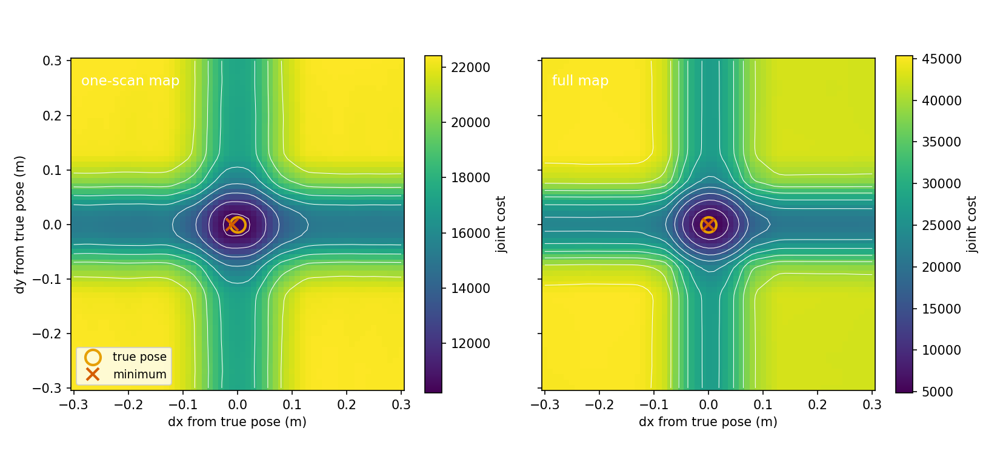

# Scan matching: the cost, the search and the optimiser

This page settles how I score a pose against a map, how I find a good pose to start from, how I refine it, and where the proposal covariance comes from. The matcher is a set of free functions in [`scan_matching.cpp`](../../src/slam_cpp/src/scan_matching.cpp). `scan_match_single` is the entry point the filter calls once per particle.

Test paths are relative to [`../../src/slam_cpp/test/`](../../src/slam_cpp/test/). How the map is read (the cell centre rule and the half-cell shrink at the edge) is in [grid.md](grid.md).

Symbols:

| Symbol | Code name | Unit and frame |
|---|---|---|
| `xi = (x, y, theta)` | `pose` | m, m, rad; map frame |
| `a_k` | row `k` of `local_scans` | m; base frame |
| `q_k` | `transform_scan_to_world(local_scans, pose)` | m; map frame |
| `p_k` | interpolated occupancy probability at `q_k` | 0 to 1 |
| `sigma` | `sigma_hit` | none |
| `xi_o` | `odom_pose`: the particle's predicted pose | m, m, rad; map frame |
| `Lambda` | `odom_info`: information matrix of the prior | per m^2, rad^2 |
| `res` | `map_resolution` | m per cell |

## The cost

For a pose `xi`, each scan point is moved to the map frame and the map is read there:

```
q_k = R(theta) a_k + (x, y)
r_k = (1 - p_k) / sigma
E_scan(xi) = 0.5 * sum_k r_k^2
```

A point on a cell I am sure is occupied has `p` near 1 and costs nearly nothing. The prior pulls the pose towards where the odometry put it:

```
d = xi - xi_o                 (the angle part wrapped to [-pi, pi))
E_odom(xi) = 0.5 * d^T Lambda d
E(xi) = E_scan(xi) + E_odom(xi)
```

Lower is better. The sum runs over the points that `scan_indices` selects, or over all points.

What a point costs depends on the cell it lands on. At the defaults (`sigma = 0.05`, `log_odds_scale = 20`), by arithmetic from the formula and not by measurement:

| Cell | `p` | `r` | `0.5 r^2` |
|---|---|---|---|
| unknown | 0.5 | 10.0 | 50.0 |
| one hit (stored 17) | 0.7006 | 5.99 | 17.9 |
| saturated hit (stored 100) | 0.9933 | 0.13 | 0.009 |
| one free step (stored -8) | 0.4013 | 11.97 | 71.7 |
| saturated free (stored -100) | 0.0067 | 19.87 | 197.3 |

So a point on a cell that rays have crossed costs more than a point on unknown space. A point on a wall costs less. The map is not a likelihood in any exact sense. I use `(1 - p)` as a residual because it is cheap and its gradient is easy.

**Off the grid.** A point is usable when all four cells around it are on the grid. A point with any of the four off the grid is charged `r = 0.5 / sigma`, the residual of an unknown cell. Leaving the grid is then never cheaper than staying on unmapped space.

**Where this comes from.** Hector SLAM minimises the sum of `(1 - M)^2` over the scan end points, where `M` is the map value interpolated at the end point (Kohlbrecher, Meyer, von Stryk and Klingauf, 2011). Mine is the same residual divided by `sigma`, with an odometry term, the off-grid charge, and a damped step. I do not claim it is equivalent to Hector's matcher. I did not check equation numbers when I wrote this page.

**The prior.** `scan_match_single` takes the particle's predicted pose and its covariance `C`. It raises each diagonal entry of `C` to at least 0.01, adds `1e-9` to the diagonal, and inverts with an LDLT factorisation to get `Lambda`. If the matrix cannot be inverted, `Lambda = 10 I`. The floor means the prior is never tighter than a standard deviation of 0.1 in each of x (m), y (m) and theta (rad). The floor is one number for three axes of different units. That is a simplification.

What the floor does, measured offline. The room has walls on all sides. The full filter, 24 m circular path, seeds 1 to 5 and 42, exact odometry, 180 points, on an earlier commit than the present one. Mean rms position error over the seeds:

| Variant | Mean rms |
|---|---|
| as shipped, floor 0.01 | 0.0350 m |
| propagated covariance replaced by the constant 0.01 I | 0.0350 m |
| floor 1e-4 | 0.0347 m |
| floor 1e-6 | 0.0356 m |

The propagated covariance changed nothing to four decimal places. Lowering the floor moved the error by 1 mm or less, inside the spread between seeds. I did not measure a corridor, where a scan does not observe one axis. There the prior would decide, and I make no claim about it. On the drive-script room, in scratch copies of the core with the floor constant changed (`filter_run_dump` has no floor option) and run through the same loop (360 points, 0.1 m cells, seeds 1, 4, 42), floors of 0.01, 1e-4 and 1e-5 gave 0.0075 to 0.0082 m, so the floor made no measurable difference there either. See [scan-density.md](scan-density.md).

Checked by `ScanMatchingTest.ComputeJointCostLowerAtTruePose` (`scan_matching_test.cpp`), `ScanMatchingProperty.InGridCostIsSumOfInterpolatedResiduals` and `ScanMatchingProperty.EmptyGridCostIsConstantPerPoint` (`scan_matching_property_test.cpp`) for the cost, and `ScanMatchingTest.JointCostChargesOffGridPointAsUnknownCell` for the off-grid charge. No test targets the covariance floor or the `10 I` fallback on its own; they rest on the argument above.

## Reading the scan

`extract_local_scan` keeps every `stride`-th beam from index 0. A beam is kept when its range `r` is finite and satisfies `r > 0`, `range_min <= r < range_max`. Its point is `r (cos a, sin a)` with `a = angle_min + i * angle_increment`. The window is inclusive at `range_min` and exclusive at `range_max`, so a beam that returns exactly the maximum range is dropped.

Checked by the `ScanMatchingTest.ExtractLocalScan*` tests and `ScanMatchingProperty.ExtractLocalScanKeepsExactlyInWindowBeams`.

## Coarse search

The optimiser below is a local method. The coarse search finds a start near the right basin. It tries poses around the odometry pose and keeps the one with the highest sum of `p_k`:

```
score(c) = sum_k p_k(c)       over the thinned points that are on the grid
```

It ignores the odometry term and does not divide by the number of points. The candidates are `(x + i*res, y + j*res, theta + dtheta)` for a shift `i, j` in whole cells and a turn `dtheta`. The window depends on `map_quality`, the share of confident cells that are occupied (see [`occupancy_grid.hpp`](../../src/slam_cpp/include/slam_cpp/occupancy_grid.hpp)):

| `map_quality` | Shifts `i`, `j` | Turns `dtheta` | Candidates | Thinning |
|---|---|---|---|---|
| below 0.2 | -3 to +3 | 0, +0.1, -0.1 rad | 147 | every 5th point |
| 0.2 or more | -1, 0, +1 | 0, +0.05, -0.05 rad | 27 | every 3rd point |

The turn is the outer loop and each list starts at zero (shifts 0, +1, -1, +2, -2, ...), so the odometry pose is the first candidate. A candidate replaces the best only if its score is strictly higher, so on ties the odometry pose wins. On an empty map every in-grid point reads 0.5, so candidates tie unless one puts points off the grid, which lowers its score. The search then returns the odometry pose, unless no shifted candidate keeps more points on the grid than the odometry pose does; if one does, it can win.

Once `map_quality` is above 0.01, a candidate with fewer than 20 percent of the thinned points on the grid is skipped. If every candidate is skipped the odometry pose is returned.

Because the search ignores the prior, it can return a pose that costs more than the odometry pose. `scan_match_single` therefore compares the joint cost `E` of the coarse result with that of the odometry pose and starts the optimiser from the lower.

The thresholds 0.2, 0.01 and 20 percent and the window sizes are constants I chose. I have no measurement that tunes them.

Checked by `ScanMatchingTest.CoarseSearchFindsCorrectPose` (it checks x and y within 0.5 m on one map), `ScanMatchingTest.MatchNotWorseThanOdometryWhenCoarseSearchJumps` and `ScanMatchingProperty.MatchIsNeverWorseThanOdometry`. No test targets the window table or the 20 percent rule.

## The optimiser

`lm_optimize` is Levenberg-Marquardt on `E`. With the residuals `r` (one per usable point) and `J = dr/dxi`, the Jacobian rows are, for the interpolated value `p` with sample coordinates `(sx, sy)`:

```
dp/dsx = (1 - fy)(p10 - p00) + fy (p11 - p01)
dp/dsy = (1 - fx)(p01 - p00) + fx (p11 - p10)
dr/dx  = -(dp/dsx) / (res * sigma)
dr/dy  = -(dp/dsy) / (res * sigma)
dr/dtheta = dr/dx * (-ry) + dr/dy * (rx)        with (rx, ry) = R(theta) a_k
```

where `pij` is the probability of the cell at offset `(i, j)` from the lower corner of the four. The last line is the chain rule: a turn moves a point by `(-ry, rx)` per radian. The derivative is taken through the interpolation of probabilities, not through the sigmoid.

Each iteration forms

```
H = J^T J + Lambda
g = J^T r + Lambda d
(H + lambda * trace(H) / 3 * I) delta = -g
```

`J^T J` is the Gauss-Newton approximation. It drops the term with the second derivative of the map. The damping is added in proportion to the mean diagonal of `H`, so it scales with the size of the cost. It is one number for three axes of different units, so it does not follow each axis separately.

A step is accepted if `E` at `xi + delta` is lower than at `xi`, computed over the same points that produced `J`. After an accepted step `lambda` is multiplied by `lm_lambda_down` and not allowed below `lm_lambda_min`. After a rejected step it is multiplied by `lm_lambda_up` and capped at `lm_lambda_max`. After a failed solve or a step that is not finite it is multiplied by `lm_lambda_up` with no cap. At most `lm_max_sub_iters` damped tries are made per iteration and `lm_max_iters` iterations in all. A damped step with norm below `1e-5` is not applied and ends the run.

The optimiser stops when no damped try lowers `E`, when the accepted step is shorter than `1e-4` (norm of `delta`, mixing m and rad), or at the iteration limit. It reports failure only when fewer than 10 points are usable at the pose it linearises. On failure the filter keeps the predicted pose. If fewer than 10 points are usable at the returned pose after an accepted step, `H` is `Lambda` alone and success stays true.

The Hessian it returns is `J^T J + Lambda` evaluated at the returned pose, not at an earlier iterate.

Checked by `ScanMatchingTest.LmFromTruePoseOnOwnMapSucceeds`, `ScanMatchingTest.LmHessianIsEvaluatedAtReturnedPose` and `ScanMatchingTest.BilinearGradientsMatchFiniteDifferences` (the gradient of the interpolation, one point, to 0.1, and it can skip, `scan_matching_test.cpp`). `LmFromTruePoseOnOwnMapSucceeds` asserts success and a pose within 0.055 m and 0.002 rad of the truth. No test checks the damping schedule, the stop rules or the failure case. No test checks the three Jacobian columns against finite differences of the cost, so the chain rule line above rests on the argument.

## The proposal covariance

The filter samples the next pose of each particle from a Gaussian around the refined pose. I take its covariance from the curvature of the cost at the minimum:

```
P = H^{-1} + 1e-5 I
```

Reading `E` as a negative log density, `H^{-1}` is the Laplace approximation of the posterior of the pose. I treat the scan points as independent, which they are not (neighbouring points on one wall are strongly correlated), so `P` is probably narrower than the true spread. I have not measured how much.

If `H` is not positive definite, or the match failed, `P = 1e-8 I`. That is much narrower than a normal `P`, so a failed match leaves the particle almost where the motion model put it.

As I read Grisetti, Stachniss and Burgard (2007), they build their proposal by sampling poses around the scan-match mode and fitting a Gaussian to them, and they weight by a sum over those samples. I use the Hessian instead, and I do not weight that way. See [weights-resampling.md](weights-resampling.md).

No test checks the proposal covariance. It rests on the argument above.



*Joint cost of a scan taken 0.06 m from the first pose on a one-scan map, and of a scan taken 0.75 m along the straight on a map built along it; 360 points, 0.1 m cells.*

## Assumptions and limits

- The optimiser sees only the map's local slope. In a long featureless corridor the scan does not constrain the motion along it, and the prior decides. I did not test this case.
- The coarse search window is a fixed number of cells, so at a small cell size it reaches less far in metres.
- Everything here assumes the lidar sits at the `base_link` origin. See [limits.md](../architecture/limits.md).
