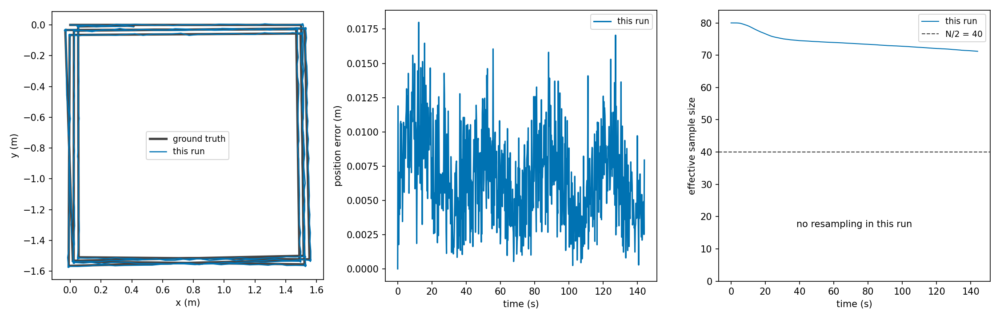

# Weights, resampling and the best particle

This page settles how a particle gets its weight, when the set is resampled, which particle I call the best, and why copying a grid is cheap. The code is `calculate_log_weight` in [`scan_matching.cpp`](../../src/slam_cpp/src/scan_matching.cpp) and `update_and_resample` in [`particle_filter.cpp`](../../src/slam_cpp/src/particle_filter.cpp).

Test paths are relative to [`../../src/slam_cpp/test/`](../../src/slam_cpp/test/).

Symbols:

| Symbol | Code name | Unit |
|---|---|---|
| `N` | `num_particles` | count |
| `l_i` | `log_weight` of particle `i`, one update | natural log, no unit |
| `w_i` | `weights_(i)` | none; sums to 1 |
| `C_i` | `cum_log_weights_(i)` | natural log |
| `g` | gain `1 / (obs_sigma_gain * N)` | none |
| `p_ik` | map value at scan point `k` for particle `i` | 0 to 1 |

## The weight of one update

After the scan matcher has refined particle `i`'s pose, its map is read at that refined pose. For every `score_stride`-th scan point:

```
l_i = g * sum_k ln( clamp(p_ik, 1e-9, 1) )
```

A point with a surrounding cell off the grid has no value. It is scored as `p = 1e-9`, which gives `ln = -20.7`. An unknown cell gives `ln 0.5 = -0.69`. So the weight penalises an off-grid point about 30 times as much as an unknown cell, while the matcher's cost charges the two the same. I know the two rules disagree and I have not measured what that does to the weights. See [limits.md](../architecture/limits.md).

The weight is computed at the refined pose. The particle then moves to a pose sampled around it, and its map is written at the sampled pose. The weight is not recomputed there.

The weight uses only the scan term. It does not use `sigma_hit` and it has no motion model term. Grisetti, Stachniss and Burgard (2007) weight each particle by a sum, over poses sampled near the mode, of scan likelihood times motion probability. As I read it, I do not do that.

**The gain.** `g` flattens the weights. Two particles whose raw log likelihoods differ by `D` have a weight ratio `exp(g * D)`. At the defaults (`N = 80`, `obs_sigma_gain = 3`), `g = 1/240`. A ratio of 2 then needs `D = 166`. This is arithmetic. I took the form of the gain from GMapping, whose `ogain` is 3.0 in its ROS wrapper as I read its source, but its per-beam score is a squared end point distance over a variance, not a log occupancy probability. The same number does not give the same flatness, so I do not claim the same behaviour.

No test checks the weight value on its own. It rests on the argument above.

## Accumulating and normalising

```
w_i <- w_i * exp( l_i - max_j l_j )
w_i <- w_i / sum_j w_j
```

Subtracting the maximum keeps the exponential finite. If the sum is below `1e-200`, or any weight is not finite, all weights are reset to `1/N`. Between resamples the weights carry over, so `w_i` is the product of its factors since the last resample.

Checked by `ParticleFilterTest.SecondUpdateMatchesAgainstTheMap` for normalisation (`particle_filter_test.cpp`). No test reaches the reset branch.

## Effective sample size and the resampling rule

```
N_eff = 1 / sum_i w_i^2
resample when N_eff < N / 2
```

`N_eff` is `N` when the weights are equal and 1 when one particle has all of them. The threshold `N / 2` is a common choice and I did not tune it.

Systematic resampling places `N` probes `u_m = r + m / N`, `m = 0 .. N-1`, with one `r` drawn uniformly from `[0, 1/N)`. Probe `m` picks the first particle `i` whose cumulative weight `sum_{j<=i} w_j` is at least `u_m`. A particle with weight `w` is picked `floor(N w)` or `ceil(N w)` times, and the whole set uses one random number. After the pick the weights are reset to `1/N`.

What I measured. These are offline runs with a synthetic rectangular room, 180 points, 1 cm range noise, a 24 m circle of 400 updates, 80 particles, exact odometry, with the default gain.

| Run | Lowest `N_eff` read after an update | Resamples |
|---|---|---|
| seed 42 | 40.1 | 2 |
| seed 42, odometry translation scaled by 1.05 | 40.0 | 3 |
| seeds 1 to 5 and 42, as shipped (an earlier commit) | 40.0 | 11 or 12, summed over the six seeds |

`N_eff` is read after `update_and_resample` (`particle_filter_integration_test.cpp`, and the status log in `slam_node.cpp`). A resample has by then reset the weights to `1/N`, so the value is the lowest seen on an update that did not resample. The true minimum was below 40 and I did not record it. In one simulator run the lowest logged `N_eff` was also 40.0, read the same way. I have not repeated this with 360 points. The tests below set `obs_sigma_gain` to 0.03 or 0.003 so that the filter resamples.

Checked by `ParticleFilterTest.BestParticleSurvivesResampling` (it requires at least two resamples in its run). No test checks the threshold or the probe positions of the resampling step on their own. They rest on the argument above.

## The best particle

I do not take the best particle from `w_i`, because resampling resets those to `1/N`, and the largest would then always be index 0. I keep a second number per particle, the cumulative log weight:

```
C_i <- C_i + l_i
C_i <- C_i - max_j C_j          (keeps the numbers bounded)
best = argmax_i C_i              (lowest index on a tie)
```

At resampling, `C` is copied with the particle: the new particle `m` takes `C` of its ancestor. So `C_i` is the sum of `l` along the particle's whole ancestry. The node publishes the pose and the map of the best particle, and builds `map` to `odom` from its pose.

Checked by `ParticleFilterTest.BestParticleSurvivesResampling` and `ParticleFilterTest.BestParticleIsACopyOfTheHeaviestAncestorAfterResampling`. The second says in its own comment that it is an empirical property of a fixed seeded run and that it does not check the values of `C`, only which slot they select.

## When a scan is written to the maps

The decision is made before resampling. The best particle's sampled pose is compared with the pose remembered at the last write:

```
write if  |position - remembered position| > map_update_dist
      or  |wrap(theta - remembered theta)| > map_update_angle
```

If the filter writes after a resample, it writes only once for each surviving ancestor, then makes the copies. After a write it remembers the pose of the best particle that survived. The first update is different: it writes the scan into every grid at the current poses and remembers that pose, with no matching.

I explain the effect of this gate on the first map in [scan-density.md](scan-density.md).

No test targets the gate on its own. `ParticleFilterIntegration.CircleWithExactOdometryTracksTruth` (`particle_filter_integration_test.cpp`) runs the whole sequence and checks a bound on the pose error: rms below 0.08 m and final position error below 0.09 m on the 24 m circle. The worst of seeds 1 to 5 and 42 was an rms of 0.0370 m.

## Copy on write

Resampling makes `N` grid copies. A grid copy shares its cells with the original through a reference count. `OccupancyGrid::update` is the only writer and copies the cell array first if it is shared. After a resample most grids are shared, and each costs memory only once it is written. See [grid.md](grid.md).

The parallel matching loop reads the grids and writes only its own particle's slots, so the sharing is safe there. Checked by `OccupancyGridTest.COWSharesUntilWrite` (`occupancy_grid_test.cpp`) for the sharing and `ParticleFilterTest.SameSeedSameResultAcrossThreadCounts` for equal results at 1 and 4 threads. The second only builds when OpenMP is found.



*Offline run with exact odometry, every beam and 0.1 m cells: the effective sample size stays above 70 and the filter does not resample in this run.*

## Assumptions and limits

- Without a resample the filter is `N` mostly independent trackers, and the weights only choose which one I publish. With the default gain the weights are flat and `N_eff` stays above `N/2` for long stretches.
- The weight and the matcher's cost treat off-grid points differently, as above.
- The best particle is the best by a long sum. A particle that was good early and bad now can stay best for a while. I did not measure how long.
